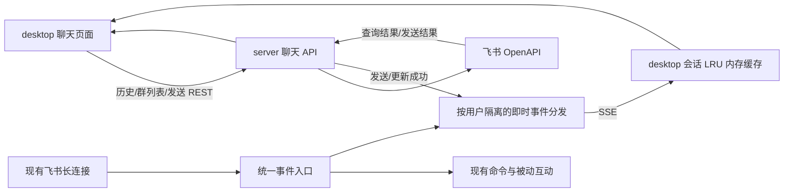

# 飞书群聊工作台实现方案：主动拉取历史 + 长连接推送

日期：2026-10-16（北京时间）

状态：当前工作区已实现核心链路；类型检查、构建、模拟接口和浏览器验证见文末。尚未在真实飞书租户联调或发布。

## 1. 已确定的范围

使用现有飞书应用机器人的身份访问其加入的群。假设所需权限已开通并发布，历史消息由飞书保存，server 按需代理查询，新消息通过现有飞书长连接接收，再推送给 desktop。

desktop 只在 renderer 内存中缓存最近访问的会话；不新增消息数据库、磁盘消息缓存、离线查看、消息关键词搜索或个人飞书账号 OAuth。

| 本期实现 | 本期边界 |
| --- | --- |
| 切换机器人，分页列出机器人加入的群 | 不预加载全部群的消息 |
| 查看最近消息，向上分页加载历史 | 消息能否返回以飞书当前可见范围为准 |
| 展开话题，分页查看话题回复 | 群主时间线与话题回复分开维护 |
| 实时接收用户消息；有对应权限时展示其他机器人消息 | 其他机器人消息只展示，不新增自动响应行为 |
| 以机器人身份发送文本、图片，引用回复、话题回复 | 不以 desktop 操作人的个人飞书身份发言 |
| 展示富文本、图片和卡片摘要，处理撤回状态 | 暂不复刻任意飞书卡片的交互运行时 |
| 按最近访问顺序淘汰会话内存缓存 | 关闭进程、退出登录后不恢复消息和草稿 |
| 新消息提示、返回最新、手动刷新 | 不承诺飞书个人客户端的未读数、已读状态同步 |

已有机器人命令、定时任务和被动互动继续独立运行。历史查询、页面切换、刷新都不能触发这些业务逻辑。

## 2. 当前仓库接入点

以下以本次读取到的工作区代码为依据。

| 文件 | 当前作用 | 需要做的接入 |
| --- | --- | --- |
| `apps/server/src/feishu/connection.ts` | 为每个 bot 建立 `WSClient`，接收消息和卡片事件 | 将聊天事件分发与命令处理分开；增加撤回、连接状态通知 |
| `apps/server/src/feishu/webhook.ts` | Webhook 消息入口 | 与长连接使用同一事件分发函数，避免两个入口行为不同 |
| `apps/server/src/feishu/message-handler.ts` | 命令、关键词检测、被动互动 | 保留业务入口，修正去重键的 bot 作用域 |
| `apps/server/src/feishu/message-parser.ts` | 提取业务需要的文本、图片、表情 | 不直接用作聊天模型；其中 `isFromCurrentBot()` 会过滤所有非 user 发送者 |
| `apps/server/src/feishu/event-dedup.ts` | 短期内存去重 | 区分 bot、事件用途和事件类型，不让展示去重吞掉业务处理 |
| `apps/server/src/feishu/api.ts` | 发消息、回复、单条查询、图片上传等 | 补历史查询；发送、更新、撤回成功后发布桌面事件 |
| `apps/server/src/feishu/commands/users.ts` | 通过 SDK 直接回复 CardKit 卡片、追加元素 | 补齐 SDK 发送和动态卡片更新通知，保留现有主群/话题关系 |
| `apps/server/src/feishu/bot-management.ts` | 按用户管理 bot；已有 `getOwnedBot()` | 导出或封装可复用的归属检查 |
| `apps/server/src/index.ts` | REST 路由注册 | 挂载聊天路由、事件流路由 |
| `apps/desktop/src/renderer/api.ts` | 带 Bearer token 的 JSON 请求 | 增加流式请求、二进制请求；保留现有调用方式 |
| `apps/desktop/src/renderer/App.tsx` | 登录、机器人管理、抖音监控 | 增加聊天入口，统一账号作用域和退出清理 |
| `apps/desktop/src/renderer/feishu/` | 现有扫码绑定 hooks | 新增独立 `chat/` 模块 |

现有 `chat-memory.ts` 是机器人被动互动使用的每群最近 30 条文本上下文，不承担 desktop 历史缓存，也不向其中灌入主动查询到的历史。

当前 `/api/feishu/connections` 返回整个连接快照；接入聊天时应按登录用户过滤，事件流使用相同的用户边界。

## 3. 总体架构与数据生命周期



| 数据 | 保存位置 | 生命周期 |
| --- | --- | --- |
| bot 配置、应用凭证、DogeBot 登录数据 | 现有 server 存储 | 沿用当前机制 |
| 历史消息权威数据 | 飞书 | 由飞书管理 |
| API 请求中的消息、发送结果 | server 当前请求/事件调用栈 | 请求、即时分发完成后释放；不保存已完成结果 |
| SSE 订阅、事件去重 ID、只读在途请求 | server 内存 | 连接期间或有界 TTL；不保存消息正文形成重放日志 |
| 已访问群的消息、话题、分页信息、草稿 | desktop renderer 内存 | LRU 淘汰、退出账号、renderer 重载或进程退出时释放 |
| 聊天图片 Blob、Object URL | desktop renderer 内存 | 有界缓存；离开视图或淘汰后释放 |

聊天 JSON 和资源代理响应使用 `Cache-Control: no-store`，客户端使用 `cache: 'no-store'`。聊天模块不将消息、草稿或图片写入 localStorage、sessionStorage、IndexedDB、文件或持久化查询缓存。

聊天资源代理不复用现有 `media/resource-cache.ts` 的磁盘缓存。原机器人图片处理所需的临时文件仍按现有生命周期管理，不作为聊天历史数据源。

当前 Electron 主窗口关闭时会隐藏到托盘，renderer 通常仍存在，因此缓存仍可保留。真正退出应用或 renderer 被重新创建后，重新主动拉取。

## 4. 飞书接口约束

实现前已核对飞书官方当前文档，需遵守以下约束：

- 群历史使用 `GET /open-apis/im/v1/messages`；机器人须在群内，权限假设不改变群保密、历史可见性等限制。
- 群历史与话题历史使用不同容器；普通对话群的主时间线不包含完整话题回复。
- 分页固定使用创建时间倒序，一次最多 50 条；续页不修改查询条件和排序。
- 群历史的时间过滤为秒级时间戳；消息时间字段转换为毫秒。话题历史不传时间过滤参数。
- `im.message.receive_v1` 不包含当前机器人自身发送的消息。发送成功结果必须进入即时分发链路。
- 读取其他机器人消息需要相应的 `include_bot` 权限；业务响应仍只处理原本允许的发送者。

依据：[历史消息](https://open.feishu.cn/document/server-docs/im-v1/message/list)、[接收消息事件](https://open.feishu.cn/document/server-docs/im-v1/message/events/receive)。

本方案不会后台扫描所有群、全量回填历史，也不维护离线补录任务。

## 5. server API 契约

下列聊天路径已实现。另有 `GET /api/me` 用于确认当前账号；除事件流外，下表以 `/api/feishu/bots/:botId` 为前缀。

| 方法与路径 | 用途 | 主要参数/返回 |
| --- | --- | --- |
| `GET /chats` | 群列表 | `pageToken?`；默认 50 条；返回群摘要、`hasMore`、`nextPageToken` |
| `GET /chats/:chatId` | 群信息 | 名称、头像、群模式等必要字段 |
| `GET /chats/:chatId/members` | 成员名字 | 当前会话按需读取，客户端最多保留 300 个名字 |
| `GET /chats/:chatId/messages` | 群历史 | `pageToken?`、`snapshotEndTimeSeconds?`；固定 50 条、倒序查询 |
| `GET /chats/:chatId/threads/:threadId/messages` | 话题历史 | `pageToken?`、必传 `rootMessageId`；固定 50 条，不接受时间过滤 |
| `GET /chats/:chatId/messages/:messageId` | 单条消息/引用定位/刷新卡片 | 校验返回消息属于路径中的群 |
| `POST /chats/:chatId/messages` | 发送或回复 | 文本或图片、目标消息、回复方式、`clientRequestId` |
| `POST /chats/:chatId/images` | 上传待发送图片 | 图片二进制；返回 `imageKey` |
| `GET /chats/:chatId/messages/:messageId/resources/:fileKey` | 获取图片 | 本期仅允许 `type=image`；鉴权后流式代理 |
| `GET /api/feishu/chat-events` | 当前登录用户的事件流 | 一个 renderer 只建立一条 SSE，覆盖其拥有的 bot |

### 5.1 统一消息与分页模型

以下是契约示意，不直接把未知上游 JSON 断言为可信类型。server 入参和上游响应使用 `unknown` 校验，再归一化；server 相对导入带 `.js`。

```ts
type ChatMessage = {
  botId: number;
  chatId: string;
  messageId: string;
  rootId?: string;
  parentId?: string;
  threadId?: string;
  sender: {
    id: string;
    idType: 'open_id' | 'app_id' | 'unknown';
    type: 'user' | 'app' | 'anonymous' | 'unknown';
    displayName?: string;
  };
  msgType: string;
  createTimeMs: number;
  updateTimeMs?: number;
  deleted: boolean;
  contentState: 'full' | 'summary' | 'unavailable';
  content: unknown;
  mentions: Array<{ id: string; name?: string; key?: string }>;
};

type HistoryPage = {
  items: ChatMessage[]; // 当前页转换为时间升序，便于插入 UI。
  hasMore: boolean;
  nextPageToken?: string;
  snapshotEndTimeSeconds?: string; // 仅群历史使用。
};
```

归一化分别适配历史 API、消息事件、发送结果三个来源，统一事件中的 `message_type` 和查询中的 `msg_type`，以及 `bot`/`app` 发送者表示。

保留结构化正文用于渲染，避免把原始 JSON 字符串、解析结果和完整纯文本重复保存三份。正文渲染不使用上游内容拼接 HTML。缺少姓名时显示 ID/机器人标识，成员名册按需加载，不为每条历史消息发用户查询。

缺少有效消息时间时，不把当前接收时间冒充发送时间；按需查单条详情补齐。历史、事件与发送结果统一按消息 ID 合并，毫秒时间相同时用 ID 做稳定展示排序，不使用时间戳代替分页 token。

### 5.2 群历史分页

首次查询由 server 设置固定的时间上界，并返回 `snapshotEndTimeSeconds`；后续携带该值和 `pageToken`，固定容器、排序、页大小。固定上界用于稳定分页范围，不代表飞书提供数据库快照。

desktop 为每一条分页链保存完整查询上下文：`botId/chatId/container/threadId/snapshotEndTimeSeconds`。刷新最新时创建新分页链，旧 token 不拼接到新链。

每页保存请求 token 和下一页 token。淘汰最旧页之后，重新加载更早消息必须从“当前保留的最旧页”的下一页 token 继续，不能继续使用已经被淘汰页末端的 token，否则会跳过被释放的消息。

分页失败保留原 token；上游判定 token 失效时提示刷新，并重新建立分页链，不循环重试失效 token。

### 5.3 发送与回复

```ts
type SendMessageInput = {
  clientRequestId: string; // 一个发送动作一个 UUID，重试同一动作沿用。
  message:
    | { type: 'text'; text: string }
    | { type: 'image'; imageKey: string };
  reply?: {
    messageId: string;
    mode: 'chat' | 'thread';
  };
};
```

- 无 `reply`：发送群主时间线消息；有 `reply`：查询目标消息确认群归属，再调用回复接口。
- `mode=thread` 设置 `reply_in_thread=true`。回复目标已经位于话题内时遵循飞书规则，UI 显示为话题回复，不承诺强制移回主群。
- `clientRequestId` 透传为飞书发送/回复的 `uuid`；不同正文使用新 UUID。已有内部调用可使用可选参数，保留原有返回类型，降低迁移影响。
- server 成功响应 `{ message, clientRequestId }`，同时向该 bot 所有已授权桌面订阅发布同一消息；客户端将乐观条目替换为真实 `messageId`。
- HTTP 响应和 SSE 到达顺序不确定，只能产生一条真实消息。
- 超时导致结果未知时显示“发送结果待确认”，先刷新最新消息，不自动换 UUID 再发。飞书去重不代表一定能取回原发送结果，也不承诺跨进程的本地请求恢复。

依据：[发送消息](https://open.feishu.cn/document/server-docs/im-v1/message/create)、[回复消息](https://open.feishu.cn/document/server-docs/im-v1/message/reply)。

## 6. 实时事件转发

### 6.1 与现有业务处理分开

新增统一入口 `dispatchFeishuMessage(bot, event)`，长连接和 Webhook 都调用它：

1. 校验消息基本标识，使用 bot 作用域的展示去重键。
2. 归一化并即时发布聊天事件，包括可访问的其他机器人消息。
3. 独立调用现有 `handleFeishuMessage()`，其现有发送者过滤与命令条件继续生效。

展示去重键建议 `chat-message:${bot.id}:${messageId}`；原业务去重键调整为 `business-message:${bot.id}:${messageId}`。撤回等变更使用自身的类型和版本去重，不能复用新消息的去重键。

去重仅保存 ID/到期时间，有 TTL 和数量上限；不记录正文。重复展示事件漏过去仍由 desktop 消息 ID 合并兜底。历史读取只调用历史服务，永不调用上述业务入口。

### 6.2 事件协议

SSE `event` 名与 `data` JSON 分开；业务事件带 `botId` 和必要的 `chatId`，不带应用凭证。

| 事件 | 数据及客户端动作 |
| --- | --- |
| `ready` | `streamId`、当前用户的 bot 连接状态；表示 server 订阅已注册，不代表飞书连接已就绪 |
| `message.upsert` | 完整归一化消息，发送成功时可附 `clientRequestId` |
| `message.recalled` | `botId/chatId/messageId/recallTimeMs`；缓存中改为撤回占位，并释放正文和资源 |
| `message.refresh` | 消息 ID、群 ID、原因；已缓存且可见时按需查详情，其余只标记待刷新 |
| `bot.connection` | bot 的连接、重连、停止状态；恢复连接时使相关缓存待校准 |
| `bot.removed` | 解绑的 bot ID；关闭对应视图并清除其缓存 |

服务端每 15 秒发送注释心跳。事件流只做即时转发，不设置可恢复历史的 `id`，不实现 `Last-Event-ID` 重放，不建立事件日志或断线消息队列。

发送成功通知必须覆盖 `api.ts` 的发送/回复路径，以及 `commands/users.ts` 的直接 SDK 回复。CardKit 元素追加、卡片内容更新完成后发送 `message.refresh`；同条卡片更新合并触发刷新，避免每追加一个元素请求一次详情。

现有 `/users` 的主群卡片、后续话题卡片关系继续按其 ID 呈现。保留现有 CardKit 创建后的等待，不借聊天改造调整回复语义。

### 6.3 SSE 传输和连接清理

desktop 使用 `fetch + ReadableStream + AbortController` 读取 SSE，以复用现有 `Authorization: Bearer ...`。不把登录 token 放到 URL；现有 `useApi()` 会调用 `response.json()`，流式请求应增加独立方法。

解析器处理 UTF-8 跨 chunk、CRLF、空行事件边界、多行 `data` 与注释心跳；不能把每个网络 chunk 当成一个事件。单个未完成事件缓冲超过 512 KiB 时断开并重新校准。

server 返回 `Content-Type: text/event-stream; charset=utf-8`、`Cache-Control: no-store`、`X-Accel-Buffering: no`，及时 flush 响应头。部署代理关闭该路由的响应缓冲，并允许长于心跳间隔的读取超时。

不让慢客户端阻塞飞书事件和业务逻辑。`res.write()` 出现背压时，关闭该客户端连接并清理订阅；不为其累积消息，依靠重新拉取恢复。无订阅时发布立即返回。

网络错误按 1、2、5、10、30 秒上限间隔重连，加入少量随机抖动；收到有效 `ready` 后重置。401 停止重连并走登录失效流程；退出登录、切换 server、renderer 销毁时主动 abort。心跳和 bot 状态分别展示，避免将 SSE 连通误判为飞书消息流正常。

SSE 框架参考：[MDN 事件流格式](https://developer.mozilla.org/en-US/docs/Web/API/Server-sent_events/Using_server-sent_events)。

## 7. desktop 内存缓存

### 7.1 默认容量

以下是本方案建议的内部常量，不是飞书限制，不新增环境变量。

| 常量 | 初始值 | 规则 |
| --- | --- | --- |
| `MAX_CACHED_CHATS` | 10 | 当前账号跨所有 bot 合计，按用户最近访问顺序淘汰 |
| `HISTORY_PAGE_SIZE` | 50 | 群历史和话题历史统一 |
| `MAX_MESSAGES_PER_CHAT` | 300 | 主时间线、话题、引用详情共用额度，按 ID 去重计数；最多 3 个待发送动作另计 |
| `MAX_MESSAGE_CACHE_BYTES` | 16 MiB | 所有会话消息、草稿和变更标记的估算序列化体积总额 |
| `MAX_SINGLE_CONTENT_BYTES` | 256 KiB | 超大正文返回摘要，提供打开飞书的降级入口 |
| `MAX_MEDIA_CACHE_BYTES` | 16 MiB | renderer 图片 Blob 总额，单独核算 |
| `MAX_IMAGE_BYTES` | 10 MiB | 本期单张图片上传/预览的产品上限；超限展示占位 |
| `REVISIT_REFRESH_INTERVAL_MS` | 30,000 | 健康连接下切回已缓存会话的最新页校准间隔 |

容量控制同时检查会话数、消息数和估算字节数。16 MiB 不是 JavaScript 堆占用承诺；Map、DOM、图片解码和请求过程还会占用额外内存。

### 7.2 缓存作用域和状态

整个聊天 store 绑定 `normalizedServerUrl + DogeBot userId`；内部会话键为 `${botId}:${chatId}`。重新登录、账号变更、server 地址变更时递增 `scopeEpoch` 并清空，不跨账号复用。

每个会话条目至少包含：

```text
botId / chatId / generation / lastVisitedSeq
messagesById                       所有已保留消息的唯一实体表
mainPages                          主时间线页，含入/出 token 和查询上下文
threadPagesById                     话题页；实体仍共用 messagesById
lastValidatedAt / needsResync
mainViewMode: live | history
scrollAnchor / openedThreadId
newMessageHint / draft / pendingSend
requestControllers / mutationRevision
```

引用预览只引用实体表 ID，不再复制一份完整正文。已缓存话题消息和引用详情受同一会话额度限制；另外最多保留 300 个无正文撤回标记，受总字节预算控制。分页页数、token 元数据随对应页一起回收，不无限积累已淘汰页的元数据。

现有独立应用结构下，契约类型分别放在 server 和 desktop 模块中，对照本文维护；本期不为此引入跨项目打包、共享 node_modules 或新的仓库级安装流程。

### 7.3 LRU 的明确规则

1. 只有用户选择或重新打开会话才更新 `lastVisitedSeq`。
2. 收到新消息、后台校准、收到撤回、推送连接恢复，都不提升会话的访问顺序。
3. 当前正在显示的会话不整项淘汰；切换完成后，原会话即不再受保护。
4. 插入第 11 个会话或超过总字节预算时，先淘汰最久未访问的非当前会话。
5. 未缓存群收到消息时不创建消息缓存；最多更新已加载群列表中的“有新消息”提示，不缓存正文预览。
6. 会话淘汰要删除消息、话题、分页 token、引用、草稿、变更标记、请求控制器和关联 Object URL，不留下隐藏的第二份消息集合。
7. 淘汰发送中的会话不撤销已提交给飞书的动作；响应到达时可提示结果，但不能因此重新创建该会话缓存。

例：依次访问 A 到 J 后再访问 K，淘汰 A。即使 A 持续收到群消息，也不会被重新加入缓存；再次点击 A 时重新向飞书拉取。机器人切换不会各自额外获得 10 个额度。

### 7.4 单会话超过 300 条时

按页维护有界窗口，保护当前可见区域和打开话题的可见区域，优先丢弃离可见区域最远的完整页：

- 正在最新位置：新消息追加，优先释放最旧页；仍可通过正确的下一页 token 再向前查阅。
- 向上查更早历史：优先释放靠近最新端、已离开可见区域的页，标记 `newerTruncated=true`。
- 最新端被释放后，不将新推送直接拼在旧历史后面；只增加新消息提示。点击“返回最新”重新加载最新窗口。
- 不把中间存在缺口的两段消息显示成连续历史。本期不实现多段历史之间的任意双向漫游。
- 主时间线和话题共用额度；关闭话题后，其非可见页可以优先释放。至少保留当前可见页，若超大正文仍使预算不满足，使用摘要占位。
- 被淘汰页的实体如已无主线、话题或引用视图引用，立即从 `messagesById` 删除；不能只删除列表 ID。

因此用户可以持续向更早日期翻页，但客户端不会把已经浏览过的全部记录永久留在内存。

### 7.5 防止迟到请求恢复已淘汰会话

每个异步请求捕获 `{ scopeEpoch, chatKey, generation, queryGeneration }`。写入前四项都必须与当前 store 匹配，且目标条目仍存在；否则丢弃结果，不调用“获取或创建条目”。

整项淘汰时 abort 可取消的历史、详情、图片请求；刷新分页链时递增 `queryGeneration`。单个分页链只允许一个续页请求，重复点击复用在途 Promise。切换会话后允许仍在缓存的后台结果更新其原条目，不能污染当前选中的会话。

### 7.6 图片缓存

消息只保存资源 key，不将图片转成 Base64 放入消息对象。图片进入可见区域后通过带 Authorization 的 fetch 获取 Blob，使用 Object URL 展示。

图片缓存按资源访问顺序有界淘汰，关联会话整项淘汰时释放引用。关闭预览、替换图片、撤回消息、退出账号时调用 `URL.revokeObjectURL()`；请求未完成时先取消。预算不足时显示占位和“点击加载”，不让活动图片获得无限容量豁免。

server 图片上传使用路由级二进制解析和大小限制，复用现有 `uploadImage()`，避免增加磁盘上传中转。图片资源接口校验消息属于目标群后代理飞书响应，不开放任意 URL 下载。

依据：[消息资源接口](https://open.feishu.cn/document/server-docs/im-v1/message/get-2)。

## 8. 拉取、实时合并与断线恢复

### 8.1 首次进入会话

1. 创建或访问 LRU 条目，显示加载状态。
2. 确保用户级 SSE 已开始连接；正常情况下收到 `ready` 后查询最新页。
3. `ready` 超过 3 秒仍未到达时，允许继续拉历史并显示“实时连接尚未就绪”，不能无限等待事件流。
4. 页面已建立条目后到达的推送立即合并；历史返回也合并到同一实体表，不能整体覆盖消息 Map。
5. SSE 之后恢复时再校准最新页，覆盖“先拉取、后成功订阅”期间的缺口。

连接先注册再发 `ready`，页面请求与订阅之间的竞态由消息 ID 合并和恢复校准处理，不假设两条网络链路存在事务。

### 8.2 合并与撤回竞态

- 同一 `(botId, messageId)` 只有一个消息实体，群 ID 必须一致。
- 可用的 `updateTimeMs` 较新者优先；同版本可补齐缺失的发送者、结构化内容等字段。
- 历史请求记录开始时的 `mutationRevision`。请求期间已被实时事件修改的字段，不被缺少版本或版本较旧的响应覆盖。
- 撤回产生有界占位标记；即便正文尚未加载，也要保护正在进行的历史响应，防止旧响应将其复活。
- 占位标记计入会话数量/字节额度；没有相关缓存、没有在途请求时，不为未知消息长期保存标记。
- 推送、API、乐观发送只触发一次 UI 条目与一次提示，不使用 event ID 替代消息 ID 去重。

### 8.3 切回缓存会话

立即使用健康的内存缓存恢复视图；距上次校准超过 30 秒时只刷新当前会话最新页，不拉取全部 10 个会话。

最新页与缓存主线有重叠且缓存未标记断线缺口时，可以合并并保留原分页链。校准使用独立查询，不将其 token 接在旧链后；用户显式“刷新”则建立全新的分页链。

最新页没有任何重叠时，不推断中间只有 50 条消息：当前在最新位置则替换为新最新窗口并重建分页；正在阅读旧历史则保留当前锚点，显示“有新的消息区间，返回最新查看”，不直接拼接。

### 8.4 SSE/飞书长连接恢复

本方案不提供事件重放。每次 SSE 重建后，将所有已缓存会话标为 `needsResync`；飞书某个 bot 重连恢复时，只标记该 bot 的会话。

当前在最新位置：先订阅恢复，再重新拉最新页；使旧分页链失效，以新窗口替换并合并本轮请求期间的新事件。非当前会话在下次打开时再校准，不后台批量补历史。

正在阅读旧历史：不强行滚到底部，保留画面并标明需要刷新；用户返回最新时重建窗口。不把断线后的新消息直接接到旧窗口上，也不把 `hasMore=false` 误当作已补齐缺口。

打开的话题单独刷新其最新页；话题查询不使用群时间游标。旧话题分页链在断线后失效，需要重新建立。

网络不可达时显示连接异常，不提供离线浏览入口或脱机发送队列。保留当前画面用于恢复，再次访问仍要在线校准；网络失败保留画面和错误提示，恢复后以新查询结果校准。

### 8.5 消息编辑和动态内容的边界

本期对新消息和撤回提供实时更新。自己通过 DogeBot 修改的卡片发送 `message.refresh`。不假设飞书为所有第三方消息编辑、所有卡片变化提供完整推送。

重新拉取或用户手动刷新时读取当前内容；不承诺长期驻留的每条旧消息都实时同步所有编辑。现有页面只读预览卡片摘要，不执行任意第三方卡片回调。

## 9. 群主线、话题与页面交互

desktop 新增“群聊”入口，建议用主区域标签切换“机器人管理 / 群聊 / 抖音监控”，不把完整聊天面板继续堆在机器人管理卡片内。

```text
┌ 机器人选择 ── 群列表 ┬────────── 消息区 ──────────┬── 话题侧栏（按需） ┐
│ 分页群列表            │ 群名、连接状态、刷新        │ 根消息摘要          │
│ 最近访问提示          │ 历史消息 / 加载更早         │ 话题历史            │
│ 当前会话高亮          │ 新消息提示 / 返回最新       │ 加载更早            │
│                      │ 引用目标、文本/图片输入     │ 话题回复输入        │
└──────────────────────┴────────────────────────────┴─────────────────────┘
```

- 群列表数据来自群列表 API，群消息缓存来自 LRU，两者独立。淘汰消息缓存不会让群从列表消失。
- 群列表加载本身不创建消息缓存。切换 bot 时只加载其群摘要，必要时分页；不逐群取“最后一条消息”制造 N+1 请求。
- “最近访问”来自本进程访问顺序；新消息提示仅覆盖本次连接期间观察到的变化，冷启动不显示虚构的历史未读计数。
- 主线有 `threadId` 的根消息提供“查看话题”；话题中的回复进入话题实体和提示，不重复当成普通主群消息追加。普通引用回复没有 `threadId` 时仍属于主群时间线。
- 回复方式分别是“引用回复”和“话题回复”；输入框始终显示当前发言机器人。话题侧栏默认回复该话题。
- `chatMode=topic` 的群按根消息和话题回复展示；不能把已有话题回复强制发送到主群。群模式从群信息读取，未知时不猜测。
- 首期文本和富文本安全渲染；图片按需预览；文件、语音、视频、表情等未实现类型显示类型摘要。资源接口不支持表情包下载时显示占位。
- Enter 发送、Shift+Enter 换行，并判断输入法 composition 状态；支持粘贴和选择图片。发送中、失败、结果待确认有独立状态。
- 用户停留旧消息时，新消息不强制滚动；加载更早、图片尺寸变化后保持可见消息锚点。
- 复杂卡片和未支持类型显示摘要并提示在飞书查看；本期不新增尚未验证的群 AppLink 跳转协议。

## 10. 鉴权、请求与失败处理

### 10.1 用户与群的范围

所有聊天路由先 `requireAuth`，再校验 bot 的 `user_id`。历史、发送、图片、详情和 SSE 使用相同规则。对非本人 bot 返回 404，不仅依赖客户端传来的 bot ID。

单条消息、引用目标、图片资源都验证返回的 `chatId` 与路由一致。话题查询也须确认话题的根消息属于该群，不能只验证 bot 有读取某个话题的能力。

订阅只接收登录用户拥有的 bot 事件。bot 新增/解绑时更新允许集合；心跳期间重新验证登录会话，失效则关闭流，不能把长连接当作永久授权。

server 日志仅记录 bot/chat/message ID、消息类型、耗时和错误码。现有长连接中的正文预览日志应去除，避免进程日志变成正文存档。不要打印 token、App Secret、完整消息或图片内容。

### 10.2 请求上限与异常

- 只读飞书调用按 bot 最多 2 个并发，另加进程级最多 8 个；等待队列有界。同请求只合并在途 Promise，完成后不缓存消息结果。
- 优先当前会话查询，取消已淘汰会话的等待请求；不引入 Redis、消息队列或后台全群同步。
- 上游限流返回可识别错误和等待提示；读取可由当前界面重试，发送不做不确定结果的自动重发。飞书同群发消息还有共享限频，既有命令与人工发送都可能占用额度。
- 请求超时必须真正将 AbortSignal 传入上游 fetch；可参考仓库并发工具，但不把子进程任务限制器当作无需检查的网络调度实现。
- SSE 故障、飞书长连接故障和 HTTP 查询故障分开显示。SSE 暂不可用、REST 正常时仍可手动查询与发送。
- DogeBot 登录失效的 401 才触发登录清理。飞书权限/退群错误不清除整个账号，只标记对应群不可访问并释放其正文、资源缓存。
- 网络失败保留本次有效分页上下文，不把错误转换成“群没有历史消息”。

基础错误响应保持 `error` 字符串，附可选 `code`、`upstreamCode`、`retryAfterMs`，方便兼容现有 `useApi()` 并扩展聊天界面的分类提示。

## 11. 建议文件与职责

以下为建议新增文件；实际实现中可合并小文件，不要求提前建立空模块。

```text
apps/server/src/feishu/chat/
  types.ts                  REST / SSE 契约和上游窄类型
  normalize.ts              三种消息来源归一化
  history.ts                群、历史、话题、资源访问及只读请求控制
  events.ts                 即时发布、订阅隔离、入口分发
  routes.ts                 REST、SSE、图片路由

apps/desktop/src/renderer/feishu/chat/
  types.ts                  对应 REST / SSE 契约
  api.ts                    聊天 REST、流式 fetch、图片 fetch
  cache.ts                  LRU、页窗口、预算、合并与清理
  store.ts                  账号作用域状态与 UI 订阅
  use-chat.ts               会话选择、翻页、刷新、发送
  use-chat-events.ts        SSE 生命周期与恢复校准
  components/
    FeishuChatPanel.tsx
    ChatList.tsx
    MessageList.tsx
    MessageItem.tsx
    MessageComposer.tsx
    ThreadPanel.tsx
```

沿用 React、Arco、Express 和原生 fetch；不先引入新的状态管理、聊天 SDK 或数据库。聊天 store 与现有抖音持久化 state 分开，不复用 `usePersistentState()` 保存聊天。

若后续实现决定把常量开放为环境变量，必须统一 `DOGEBOT_` 前缀、通过 `config.ts` 解析，并同步 `Readme.md` 和 `AGENTS.md`；本方案首期直接使用模块常量。

## 12. 分步实施与完成标准

### 第一步：只读历史链路

实现 bot 归属校验、群列表、群/话题历史、单条详情和归一化；desktop 实现机器人选择、分页群列表、主线和话题的只读视图。

完成标准：从飞书读到真实历史；主群与话题不混排；翻页请求不会触发机器人业务；无消息落盘。

### 第二步：LRU 和有界窗口

实现 10 会话 LRU、单会话 300 条与字节预算、页级淘汰、请求 generation、滚动锚点和退出清理。

完成标准：连续访问 11 个群能够确定性淘汰；被淘汰群的新事件和迟到响应不会恢复缓存；持续翻阅旧历史不会持续增加保留数据。

### 第三步：实时事件与恢复

实现统一消息入口、SSE、撤回事件、bot 状态、REST/推送合并及断线后的窗口重建。

完成标准：首次打开与推送并发时无丢失/重复；断线跨过多页新消息后不会把有缺口的两段历史拼成连续列表。

### 第四步：发送、回复和图片

接入机器人发送、两种回复、UUID、乐观状态、图片内存预览；补齐现有自动发送和 SDK 卡片路径的即时发布。

完成标准：同一发送结果只出现一次；其他已登录桌面也收到机器人自己的发送；`/users` 的现有主群/话题输出完整显示；图片可预览且可释放。

### 第五步：联调、说明与发布准备

补齐错误态、只读降级、托盘恢复、代理 SSE 配置说明；更新 server/desktop README 中的实际接口、权限和使用说明。只在功能实现后修改这些运行文档，避免把本设计误标为已具备能力。

## 13. 验证清单

仓库不新增 Jest/Vitest。纯缓存和合并逻辑可用最小 TypeScript/Node 脚本验证；飞书行为用已授权测试 bot 联调。

| 场景 | 必须观察到的结果 |
| --- | --- |
| 顺序访问 11 个群 | 缓存至多 10 个，淘汰最久未访问的非当前群 |
| 旧群持续产生新消息 | 不提升该群 LRU，不为未缓存群创建条目 |
| 主线、多个话题和引用累计超过 300 条 | 共用额度，实体与页引用同时释放 |
| 大卡片、多图片、小图片大量累积 | 命中消息/媒体预算，降级或淘汰，不无限保留 Blob |
| 请求未返回就淘汰、重开同群或切换账号 | 旧响应被 scope/generation 检查拒绝 |
| 首屏历史返回前收到新消息、撤回 | 无重复；旧正文不覆盖新版本或复活撤回消息 |
| 加载更早并裁掉旧页后再次翻页 | 不跳过被裁掉的历史，不复用错误分页链 |
| SSE 先到、REST 先到的两种发送顺序 | 乐观条目最终只对应一条真实消息 |
| 发送超时，但飞书实际已发送 | 显示待确认；刷新或同 UUID 重试不会盲目重复发送 |
| desktop 断线期间新增超过一页消息 | 重建最新窗口，明确处理缺口，不假设只缺最近 50 条 |
| 飞书连接中断而 SSE 仍正常 | 显示 bot 断开，恢复后重新校准 |
| 同群存在两个绑定的 bot | 两个 bot 独立显示/去重，业务去重不会互相吞消息 |
| 收到其他机器人消息 | 聊天可展示；不新增机器人互相自动回复 |
| 自动回复、定时消息、`/users` 卡片与元素追加 | 桌面可见，主群/话题关系和既有处理行为正确 |
| 读取过去包含命令的消息 | 不再次执行命令、检测、通知或被动互动 |
| 退出登录、改 server、删除 bot | SSE、请求、缓存与 Object URL 按作用域清理 |
| 退群、权限失败、网络失败、群历史为空 | 四种状态能区分，不误报空历史或误退出账号 |
| 关闭到托盘再恢复、真正退出再打开 | 前者使用内存并校准；后者重新拉取 |
| 慢 SSE 消费者、代理缓冲、流中途截断 | 业务不被阻塞，客户端可检测、重连并校准 |
| 检查应用持久化位置与日志 | 无新增聊天正文、草稿、图片落盘；无正文预览日志 |

实际改动 server 后必须执行：

```bash
cd apps/server
npx tsc -p tsconfig.json --noEmit
```

desktop 先执行类型检查，再执行其项目构建：

```bash
cd apps/desktop
npx tsc -p tsconfig.json --noEmit
npx tsc -p tsconfig.renderer.json --noEmit
pnpm build
```

在 Windows PowerShell 中若 `pnpm` 受执行策略限制，使用 `pnpm.cmd`。不在仓库根目录安装依赖。只有文档变更时不运行应用构建；按链接、契约、范围和 Markdown 结构检查即可。

## 14. 官方依据与待联调事项

官方资料核对日期：2026-10-16。以下能力来自官方文档，其余容量、模块和恢复策略是本方案的实现决策。

- [机器人所在群列表](https://open.feishu.cn/document/server-docs/group/chat/list)
- [会话历史消息与话题分页](https://open.feishu.cn/document/server-docs/im-v1/message/list)
- [消息事件及其他机器人消息权限](https://open.feishu.cn/document/server-docs/im-v1/message/events/receive)
- [发送消息与 UUID](https://open.feishu.cn/document/server-docs/im-v1/message/create)
- [回复、话题模式与 UUID](https://open.feishu.cn/document/server-docs/im-v1/message/reply)
- [撤回事件](https://open.feishu.cn/document/server-docs/im-v1/message/events/recalled)
- [消息图片等资源获取](https://open.feishu.cn/document/server-docs/im-v1/message/get-2)
- [MDN：SSE 消息格式与连接](https://developer.mozilla.org/en-US/docs/Web/API/Server-sent_events/Using_server-sent_events)

尚需实际租户验证：最早可读历史、外部群/保密群、话题群分页表现、发送结果字段完整度、CardKit 动态卡片回读，以及当前部署代理对 SSE 的支持。权限齐全是本方案前提，不把这些运行表现当作已经验证通过。

## 15. 当前实现和验证记录

- 已实现 server 群/话题/成员/图片代理、用户级 SSE、撤回、现有自动发送和 SDK 卡片刷新通知。
- 已实现 desktop 工作区、LRU、有界消息窗口、图片预览、引用/话题、发送、滚动锚点和断线校准。实际小文件职责合并在 `cache.ts`、`use-chat.ts`、`FeishuChatPanel.tsx`，未预建空组件。
- 客户端消息契约与 server 保持对应；不新增消息表或持久化存储，不新增生产依赖。
- 逻辑验证脚本：`apps/desktop/scripts/verify-feishu-chat.ts`；接口模拟脚本：`apps/server/scripts/verify-feishu-chat.ts`。使用现有 tsx 和 Node assert，不引入测试框架。
- 真实租户权限、历史范围、动态卡片回读和飞书/Lark 跨租户表现仍需实际账号验证。

### 本次验证结果

- server：`tsc -p tsconfig.json --noEmit` 通过；`pnpm build` 通过。使用原有 `tsconfig.json`（`rootDir: "."`）编译到 `dist/src` 和 `dist/scripts`，保持 `pnpm start -> dist/src/index.js` 及云端部署入口一致。
- desktop：完整 `pnpm build` 通过，包含主进程与 renderer 类型检查、Vite 和 preload 拷贝。现有打包大块体积提示不影响构建成功。
- 15 项缓存/解析场景通过，包括立即释放淘汰实体、迟到请求、版本合并、撤回标记溢出保护、分页连续性、话题根消息更新、消息/图片容量和 SSE 分片。
- 6 项模拟接口场景通过，使用独立临时数据库与模拟飞书，覆盖鉴权、用户隔离、群/话题归属、UUID、自动发送、其他机器人消息、撤回、图片上传和代理。
- 使用生产构建在 Chrome 进行浏览器联调：群历史/成员名称、REST/SSE 去重、话题查看和回复、图片上传/发送/预览、960×720 布局、10 会话 LRU、淘汰后 Blob URL 失效和重新读取均通过；未出现 renderer 未捕获异常或聊天 localStorage 数据。
- 使用独立临时数据库启动编译后的 `dist/src/index.js`，确认健康检查和新聊天鉴权路由正常；没有使用真实 bot 凭证或发送真实飞书消息。

后续上线前仍需用实际机器人验证租户权限、历史可见范围、CardKit 动态回读以及生产代理 SSE。未提交或推送代码。
